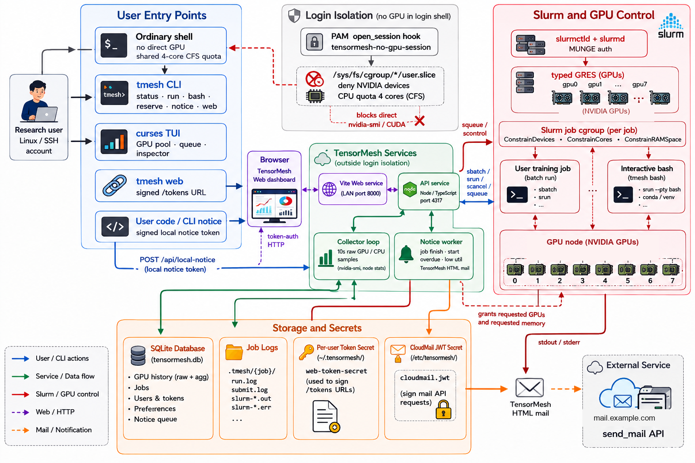

# TensorMesh

TensorMesh is a lightweight GPU management platform for shared research servers.
Slurm owns scheduling and GPU isolation; TensorMesh adds a CLI and curses TUI,
a web dashboard, live telemetry, SQLite job history, and notifications on top
of it.

It is built for single-node GPU workstations and small research clusters where
users log in over SSH and share a handful of GPUs.



## Features

- `tmesh` CLI plus a curses TUI: `status`, `run`, `bash`, `reserve`, `share`,
  `history`, `notice`, `web`.
- Web dashboard with per-user signed token access — no accounts, no telemetry.
- API service with live GPU/CPU telemetry (10s collection loop) and SQLite history.
- Interactive GPU sessions backed by Slurm + tmux, with process-level visibility.
- Optional admin components: login-shell GPU isolation, an `nvidia-smi` guide
  shim, mail reminders, and GPU sharing on occupied cards (`tmesh share`).

## Requirements

- Linux with systemd
- Node.js >= 22.5 (uses the built-in `node:sqlite`)
- Slurm client tools (`sbatch`, `srun`, `squeue`, `sinfo`, `scontrol`, `scancel`)
- `nvidia-smi` (NVIDIA driver), `tmux`, Python 3 (standard library only)
- `sqlite3` CLI (optional, for `tmesh history` fallback)

The API service runs as `root` because it collects global GPU/process telemetry
outside login-shell isolation; the web service runs as a regular user.

## Quick start

On a fresh GPU server (as a regular user with sudo):

```bash
git clone https://github.com/fanrj3/TensorMesh.git
cd TensorMesh
./install.sh
```

`install.sh` checks dependencies, installs npm packages, builds the web
dashboard and documentation, generates `/etc/tensormesh/tensormesh.env`,
renders and installs the systemd services, links `tmesh` into `/usr/local/bin`,
and runs a health check.

Then:

```bash
tmesh status                        # cluster + GPU overview
tmesh run --gpus 1 -- nvidia-smi    # one-off GPU job
tmesh web                           # print a signed dashboard URL
```

The dashboard is served on port 8000, with the documentation site under `/doc/`.

### Manual install

```bash
npm ci
npm run deploy:docs:web   # build the docs site and sync it into the web app
npm run build:web         # build the dashboard
# write /etc/tensormesh/tensormesh.env (see scripts/systemd/tensormesh.env.example)
# render scripts/systemd/tensormesh-{api,web}.service and install them
sudo systemctl enable --now tensormesh-api tensormesh-web
sudo ln -sf "$PWD/bin/tmesh" /usr/local/bin/tmesh
```

## Configuration

Configuration lives in `/etc/tensormesh/tensormesh.env`:

| Variable | Default | Purpose |
| --- | --- | --- |
| `TENSORMESH_HOST` / `TENSORMESH_PORT` | `0.0.0.0` / `4317` | API listen address |
| `TENSORMESH_WEB_PORT` | `8000` | Web dashboard port |
| `TENSORMESH_WEB_URL` | `http://<host>:8000` | URL users open (used for token links) |
| `TENSORMESH_DB_PATH` | `<install>/data/tensormesh.db` | SQLite database |
| `TENSORMESH_DEFAULT_CPUS_PER_GPU` | `4` | Default CPU cores requested per GPU |
| `TENSORMESH_DEFAULT_MEM_PER_GPU` | `24G` | Default memory requested per GPU |

Mail reminders are optional: set `TENSORMESH_CLOUDMAIL_ENDPOINT` (a
CloudMail-compatible HTTPS JSON API) and a token to enable them; every other
feature works without mail. See the
[configuration reference](apps/docs/docs/reference/configuration.md) for the
full list of variables.

## Documentation

The maintained documentation lives in [`apps/docs`](apps/docs) (Docusaurus) and
is served at `/doc/` by the web dashboard once built. To preview it locally:

```bash
npm run dev:docs
```

## Development

```bash
npm ci
npm run dev:server       # API service
npm run dev:web          # web dashboard (Vite dev server)
./bin/tmesh status       # CLI/TUI against the dev server
npm test && npm run typecheck && npm run build
```

## Optional admin components

- **Login-shell GPU isolation** (`scripts/pam`,
  `scripts/systemd/tensormesh-gpu-isolation.*`): keep login shells off the GPUs.
  Requires cgroup v1 hybrid.
- **`nvidia-smi` guide shim** (`scripts/nvidia-smi`): show a short usage hint
  instead of raw GPU output in login shells.
- **GPU sharing** (`sudo tmesh share ...`): run parallel tasks on occupied cards.

Details are in the admin guide on the documentation site.

## Uninstall

```bash
./uninstall.sh           # stop services, remove systemd units and the CLI link
./uninstall.sh --purge   # also remove /etc/tensormesh/tensormesh.env
```

## License

MIT — see [LICENSE](LICENSE).
